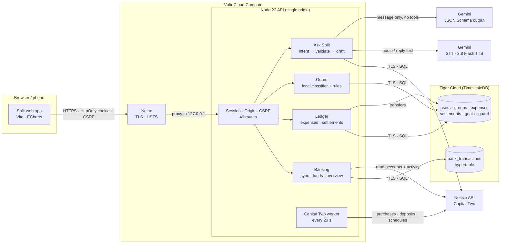
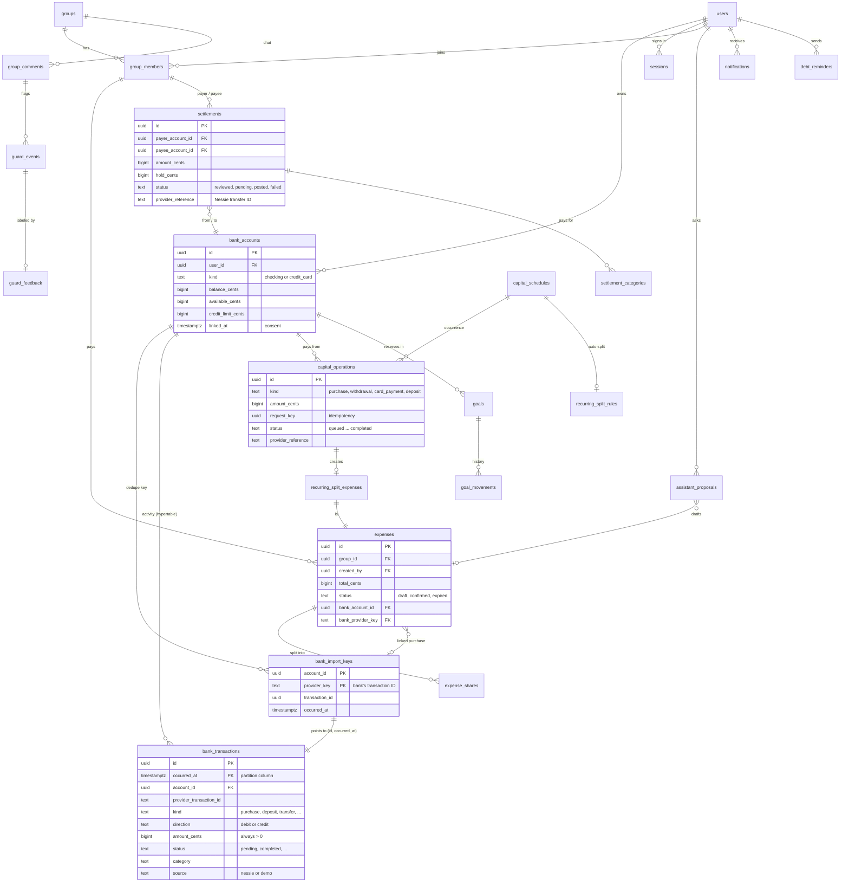

# Split

**Shared money, handled by voice, backed by a real bank, and guarded against the AI itself.**

Split is one app for your shared money life: split bills with roommates, plan trips, save toward goals, track recurring payments, and see where your money goes. You can talk to it. Say *"Split last night's pizza with Sam and Priya"* and Split finds the purchase in your bank, drafts the split, and waits for you to confirm.

The rule the whole system is built around: **the AI never moves money, and never invents a number.** Only the signed-in user can approve a payment, and every figure the assistant says is computed by application code from the database.

> Visual walkthrough of the architecture, data model and money flow: [`docs/architecture.html`](docs/architecture.html)

| | |
| --- | --- |
| **Database** | Tiger Cloud (TimescaleDB): one service, `bank_transactions` as a hypertable, 27 tables, 20 versioned migrations |
| **AI** | Gemini (intent + extraction with JSON Schema output, grounded explanations, speech-to-text, and voice replies) |
| **Bank** | Capital One Nessie API, through **Capital Two**, our sandbox bank |
| **Hosting** | Vultr Cloud Compute, Nginx + Let's Encrypt in front of a single Node origin |
| **Quality** | ~200 automated tests in 46 files, 49 authenticated API routes, 53 reviewed and merged pull requests |

---

## What you can do

- **Ask Split**: type or hold to talk. Seven intents: log an expense, check what you can afford, see who owes whom, spending insights, goal progress, reminders, and a safe refusal for everything else. Replies are read aloud.
- **Groups**: roommates, trips, friends, couples, events, work. Expenses, shares, net balances, a group chat, and settlement threads.
- **Settle up**: review a payment, confirm it, and Split sends a real Nessie transfer. It shows as paid only when the bank posts it.
- **Bank**: connect your accounts (consent first, nothing is read before you press **Allow**). Transactions sync automatically, categories can be corrected.
- **Capital Two**: our Nessie-powered bank. Checking and a credit card, merchant purchases, ATM withdrawals, payments now or on a date, monthly schedules, direct deposit, card repayment, and **Split now** on any purchase.
- **Recurring splits**: a monthly rent payment becomes a group expense automatically.
- **Goals**: set money aside for a house, car, trip or savings. Reserved money is subtracted from what you can spend.
- **Insights and Overview**: spending and earnings by day, week or month, 12-month trends, categories, salary allocation, and upcoming bills.
- **Guard**: scores every group chat message for scams, outside-payment requests, credential requests and prompt injection, and keeps an audit log of every blocked AI action.

---

## Architecture



One Node process serves the built front end and the API from the same origin, so cookies are `SameSite=Strict` and there is no CORS surface. The server has a single runtime dependency (`pg`); HTTP, sessions, rate limits and provider clients are written against Node's standard library.

---

## Data model

Bank activity is time-series data, so it lives in a TimescaleDB **hypertable** partitioned by `occurred_at`. Everything around it is relational, and the two are joined in plain SQL: an expense points at the exact bank purchase it came from, a settlement is matched to its Nessie transfer, and a scheduled rent payment becomes a group expense.



**Why `bank_import_keys` exists.** On a hypertable, every unique constraint must include the partition column. A bank's transaction ID has nothing to do with time, so uniqueness on it cannot live on the hypertable. `bank_import_keys (account_id, provider_key)` is a small relational table that owns that guarantee and points to the hypertable row by `(id, occurred_at)`. The key and the transaction are inserted in the same database transaction, so syncing the same account any number of times never adds a duplicate row or a duplicate dollar.

---

## How each technology is used

### Tiger Data

- **Hypertable for bank activity.** `bank_transactions` is created with `create_hypertable(... by_range('occurred_at'))`. Queries for a date range only touch the chunks in that range, so a "this month" chart stays fast as history grows. On a plain local Postgres the same migration keeps a normal table, so development does not require TimescaleDB.
- **`time_bucket` analytics.** The Overview chart is one query: `time_bucket` over local-time timestamps (`America/New_York`), joined to a `generate_series` of bucket starts so empty days or months come back as zeros instead of gaps. `npm run banking:overview-check` recomputes every bucket from raw rows and compares.
- **Transactions where money is involved.** Spendable funds = `available − goal reservations − settlement holds`, computed under `SELECT … FOR UPDATE` on the account row. Goal deposits, settlement holds and bank syncs take the same lock, so two actions can never spend the same dollar (`npm run banking:funds-check` races them).
- **Consistent reads.** Insights run in a `REPEATABLE READ READ ONLY` transaction, so a sync that lands mid-request cannot change half of the numbers.
- **One service for everything.** Auth, sessions, ledger, Guard, assistant proposals and notifications all live in Tiger. Each developer worked in their own schema inside the same service (`DB_SCHEMA`), and migrations are numbered by owner, checksummed, and refused if edited after merge.

### Gemini

- **Intent and extraction with JSON Schema.** Every call sets `responseMimeType: application/json` and a `responseJsonSchema`. The reply is validated again in code (`server/assistant/intent.js`): unknown fields, fractional or unsafe cents, wrong types, control characters and contradictory intent/expense pairs are rejected.
- **No tools, minimal input.** The model gets only the user's message. No account IDs, balances, credentials or history, and no function calling. Responses that contain function calls or inline data are rejected.
- **Grounded explanations.** For affordability, debts, spending and "explain this charge", application code computes every figure and writes each factual sentence. Gemini only returns an ordering of the sentence IDs it was given, and the server checks that the ordering contains each ID exactly once.
- **Speech-to-text and spoken replies.** Recorded WAV audio is sent inline to the configured Gemini model for transcript extraction; spoken replies use Gemini 3.8 Flash TTS. Provider calls stay server-side, audio and text are size-limited, and browser speech synthesis remains the fallback when Gemini voice is unavailable.
- **Cost and latency limits.** At most 4 concurrent and 30 requests per minute per process, a 25-second timeout, no automatic retries, and `thinkingLevel: minimal` for the extraction model.

### Nessie (Capital Two)

Split is designed to connect to the bank you already have: each provider's data is normalized into one internal shape (integer cents, a fixed set of kinds and statuses), and the rest of the app only reads that shape. For the demo, that bank is **Capital Two**, built entirely on Nessie.

| Nessie resource | What Split does with it |
| --- | --- |
| `customers`, `customers/:id/accounts` | Opens a checking account and a $2,000-limit credit card per user, repeat-safe |
| `accounts/:id`, `accounts/:id/transactions` | Balance snapshots and activity sync into the hypertable |
| `accounts/:id/purchases` | Merchant purchases on debit or credit |
| `accounts/:id/withdrawals` | ATM cash withdrawals |
| `accounts/:id/deposits` | Direct deposit (biweekly or monthly salary) |
| `accounts/:id/transfers` | Settle-up payments between friends, card repayments |
| `merchants` | Looks up a merchant, creates it if missing, caches the ID |
| `transactions/:id`, `transactions/:id/settle` | Status checks and settlement of pending payments |

**Payments without double-sends.** Nessie has no idempotency key for creates. Split saves each operation (with the user's request key) before calling Nessie and embeds an opaque reference in the provider description. A conditional `queued → submitting` claim picks exactly one sender across requests and processes. If a response is lost, the operation becomes **Unknown**: Split looks for the exact match by account, kind, amount and reference and adopts it, and never re-sends. Only `429` responses are retried, after `Retry-After`. New payments are limited to 30 per minute and 100 unresolved per user.

### Vultr

Production runs on a Vultr Cloud Compute instance: Node as a non-root systemd service listening on `127.0.0.1`, Nginx in front terminating HTTPS with Let's Encrypt, and the instance firewall open only for ports 80 and 443. The app requires an `https://` `APP_ORIGIN` in production, which turns on `__Host-` cookies, `Secure`, and HSTS. See [Deploying on Vultr](#deploying-on-vultr).

---

## Security model

**AI boundary**

- Gemini has no tools and no authority. Its output is a *proposal* that must pass schema validation, scope checks (every group, member and account is resolved against the session user), and explicit user confirmation.
- Identity always comes from the session, never from the request body or model output. The payer of an AI-drafted expense is always the signed-in user.
- Requests the assistant must not act on (send money, approve payments, change permissions, multiple actions in one message) are refused and written to `guard_events` with a fixed, redacted reason.
- Group notes and chat messages never reach the model or the bank. They have no code path to an action.

**Guard (chat)**

- Every new comment is scored on the server, never sent to a third party. Explicit rules for instruction override, outside-payment and credential requests add readable reasons.
- The current model (`split-guard-nb-v1`) is a bounded Naive Bayes classifier trained on the UCI SMS Spam Collection plus Split-specific examples: **99.1% precision, 83.3% recall** on a held-out set of 1,071 messages (`server/guard/evaluation.json`).
- A flagged message shows a warning in the thread; other members get a private alert. Members can label a flag as wrong. Guard is advisory: it never authorizes, blocks or rewrites a payment.

**Application**

- Passwords: salted scrypt. Sessions: random tokens stored only as SHA-256 hashes, in `HttpOnly`, `SameSite=Strict` cookies (`__Host-`, `Secure` and HSTS on HTTPS). Seven-day expiry.
- Every mutation requires the exact `Origin`, a JSON body, and the session's CSRF token. Bodies are capped at 16 KB; compressed bodies and unexpected content types are rejected.
- 10 sign-in attempts per minute per IP (forwarding headers cannot bypass it), and 5 wrong passwords lock an email for 15 minutes.
- Errors return `{code, message, requestId}` only. Provider bodies, prompts and credentials are never logged or returned. No provider variables use the `VITE_` prefix, so none can reach the browser bundle.

**Money**

- All amounts are integer cents (`bigint` in SQL, `BigInt` for sums in JS). There is no floating-point money anywhere.
- Every money-moving write carries a request key with a unique constraint; a retry returns the original result.
- Reviewed settlement terms are immutable. A settlement is `posted` only after the bank reports the transfer, and its hold is released if it fails.

---

## Engineering practices

- **Contracts first.** Each feature owner published the endpoints, payload shapes and invariants before building (`C13-CONTRACT.md`, `C14-CONTRACT.md`, `fixtures/`), so the front end and back end were built in parallel against the same fixtures.
- **Owned migration ranges.** `0001–0099` foundation, `0100–0199` groups and ledger, `0200–0299` banking, `0300–0399` assistant and goals. Feature branches never collide on filenames.
- **Database constraints, not just code.** `CHECK` constraints on every amount and status, composite foreign keys that require payers to be group members, partial unique indexes so a bank purchase can be linked to at most one confirmed expense.
- **Tests that hit real things.** Unit tests, real-HTTP tests for session tampering, CSRF and cross-origin requests, and integration tests against a live Tiger schema (provisioning races, concurrent retries, lost provider responses, restart recovery, cross-user access).
- **Operational scripts.** `db:check`, `db:verify` (fresh-schema acceptance on a throwaway schema), `nessie:smoke`, `banking:read`, `banking:sync -- --verify`, `banking:overview-check`, `banking:funds-check`, `smoke:gemini`, `smoke:ask`, `smoke:insight`.

---

## Repository layout

```
splitAI/
├── index.html, src/            Front end (Vite, vanilla ES modules, ECharts)
│   ├── features/               ask · bank · goals · guard · insights · notifications · overview · recurring · together
│   ├── api/                    session + apiRequest (CSRF header, same-origin)
│   └── lib/, styles/           routing, money formatting, read-aloud, design tokens
├── server/                     Node API (one dependency: pg)
│   ├── app.js, http.js, routes.js, session.js
│   ├── assistant/              Gemini client, intent schema, answers, voice, bank matching, Guard hooks
│   ├── banking/                Nessie provider, sync, funds, overview (time_bucket), bills, provisioning
│   ├── capital-two/            Capital Two operations, schedules, worker
│   ├── ledger/                 debts, settlements, reconciliation, recurring splits, charge explanations
│   ├── goals/, insights/, activity/, guard/, auth/
│   ├── db/                     migrations, migrate, seed, demo history
│   ├── scripts/                checks and smoke tests
│   └── test/                   node:test suites
├── fixtures/                   Contract fixtures shared by front end and back end
└── docs/architecture.html      Diagrams
```

---

## Running locally

Requires Node 22.15+ (24 recommended) and a Tiger Cloud service (or local Postgres; TimescaleDB is optional locally).

```sh
npm install
npm --prefix server install
cp server/.env.example server/.env      # set DATABASE_URL, DB_SCHEMA, DEMO_PASSWORD,
                                        # GEMINI_API_KEY, GEMINI_MODEL, GEMINI_TTS_MODEL, NESSIE_*
npm --prefix server run db:setup        # migrate + seed demo users
npm run build
npm --prefix server start               # http://localhost:3001
```

Demo users `maya@split.test`, `sam@split.test`, `priya@split.test` and `alex@split.test` use `DEMO_PASSWORD`. For hot reload, run `APP_ORIGIN=http://localhost:5173 npm --prefix server run dev` and `npm run dev` in two terminals.

```sh
npm --prefix server test                # full suite
npm --prefix server run db:check        # TimescaleDB version, hypertable status, migrations, row counts
npm --prefix server run nessie:smoke    # Nessie key and account mapping (read-only)
```

---

## Deploying on Vultr

1. Create a Vultr Cloud Compute instance (Ubuntu LTS) and attach a firewall group that allows only TCP 22 (your IP), 80 and 443.
2. Install Node 24 and Nginx. Clone the repo, run `npm ci && npm run build` and `npm --prefix server ci`.
3. Create `server/.env` with `NODE_ENV=production`, `HOST=127.0.0.1`, `PORT=3001`, `APP_ORIGIN=https://<your-domain>`, the Tiger Cloud `DATABASE_URL` (`sslmode=require`), `DB_SCHEMA=split`, and the provider keys. Run `npm --prefix server run db:migrate`.
4. Run the server as a systemd unit under a dedicated non-root user (`ExecStart=/usr/bin/node --env-file=.env index.js`, `Restart=always`).
5. Point the domain at the instance, then configure Nginx as a reverse proxy to `127.0.0.1:3001` and issue a certificate with Certbot (Let's Encrypt).

The app does not trust forwarded headers and enforces the exact `APP_ORIGIN`, so keep the Node listener private behind Nginx.

---

## Roadmap

- **Guard on DeBERTa-v3** ([#113](https://github.com/Kushagra-Aitha/splitAI/issues/113)): fine-tuned `microsoft/deberta-v3-small`, quantized ONNX running in Node, rules-only fallback, under 300 ms per message on CPU.
- **Continuous aggregates and compression** on `bank_transactions` for long histories.
- **More bank connectors** behind the same normalized provider interface.
